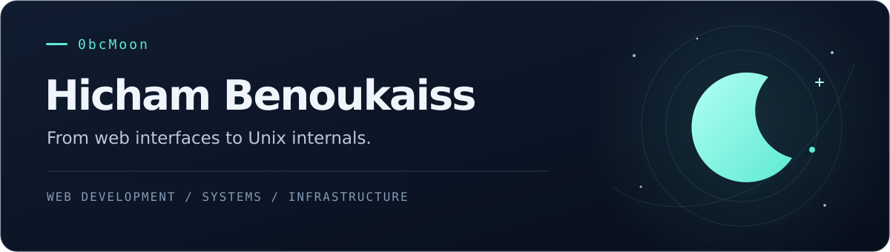

  

  <a href="#selected-projects">Projects</a> &nbsp;·&nbsp;
  <a href="hichambenoukaiss.me">Portfolio</a>
  <a href="https://www.linkedin.com/in/hibenouk/">LinkedIn</a>

### From web interfaces to Unix internals.

I'm **Hicham Benoukaiss**, also known as **0bcMoon**. I build web applications and explore systems programming—from React interfaces and backend APIs to Unix tools in C and C++.

I enjoy working across the stack: creating interfaces, handling authentication and real-time communication, understanding processes and networking, and deploying applications.

## Selected projects

### Web development

| Project | What I built and explored | Stack |
| :--- | :--- | :--- |
| **[ft_transcendence](https://github.com/0bcMoon/ft_transcendence)** | Team-built multiplayer Pong platform; my focus was authentication, OAuth2, 2FA, and real-time chat | React · TypeScript · Fastify · SQLite |
| **[todo-app](https://github.com/0bcMoon/todo-app)** | Project and task tracker with a React frontend, Go API, and database-backed sessions | React · Go · PostgreSQL |
| **[portfolio](https://github.com/0bcMoon/portfolio)** | Personal portfolio presenting my projects, experience, and skills | Astro · TypeScript · Tailwind CSS |
| **[inception](https://github.com/0bcMoon/inception)** | Containerized WordPress deployment with Nginx, MariaDB, Redis, and supporting services | Docker · Nginx · WordPress |

### Systems & infrastructure

| Project | What I built and explored | Stack |
| :--- | :--- | :--- |
| **[Webserver](https://github.com/0bcMoon/Webserver)** | HTTP server with static files, CGI, virtual hosts, and configuration parsing | C++ · HTTP |
| **[minishell](https://github.com/0bcMoon/minishell)** | Interactive Unix shell with built-ins, pipelines, redirections, and variable expansion | C · Unix |
| **[inception-of-things](https://github.com/0bcMoon/inception-of-things)** | Kubernetes lab with K3s VMs, ingress routing, Argo CD, and a GitLab bonus | Kubernetes · K3d · GitOps |

More systems work: [Fractal graphics](https://github.com/0bcMoon/fract-ol) · [Thread synchronization](https://github.com/0bcMoon/Philosophers)

## Projects in progress

- **[Expert System](https://github.com/0bcMoon/expert-system)** — In progress · Rust.
- **Red Tetris** — In progress.

## Tools I work with

**Languages** &nbsp; C · C++ · Rust · Go · TypeScript · Shell

**Web** &nbsp; React · Astro · Fastify · Tailwind CSS · PostgreSQL · SQLite

**Systems & infrastructure** &nbsp; Linux · Docker · Kubernetes · K3s · K3d · Argo CD

**Development** &nbsp; Git · Make · Neovim

## On my workbench

- **Problem solving:** practicing C++ through [competitive programming](https://github.com/0bcMoon/Competitive-programming).
- **Web development:** maintaining my [portfolio](https://github.com/0bcMoon/portfolio).

---

  Interested in web development, systems programming, or infrastructure? 
  <a href="https://www.linkedin.com/in/hicham-benoukaiss-049a96255/">Let's connect on LinkedIn.</a>

